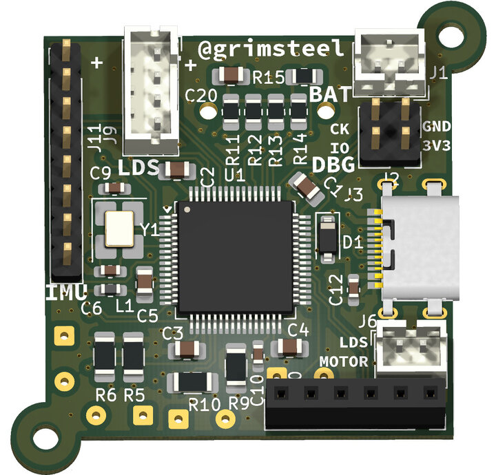

# SLAM

EKF-SLAM on an STM32

Project progress:
- [x] SLAM implementation (theoretical)
- [x] Robot w/ lidar
- [x] Dead reckoning
- [x] Linear motion model 
- [x] Landmark detection (LiDAR)
- [ ] STM EKF filter
- [ ] STM EKF-SLAM (& landmark storage)

[Robot CAD](https://cad.onshape.com/documents/9e30bb890a60f460f17f0578/w/5d32139569da3ee478d63869/e/addadc4122316ab2e6a7443b)
